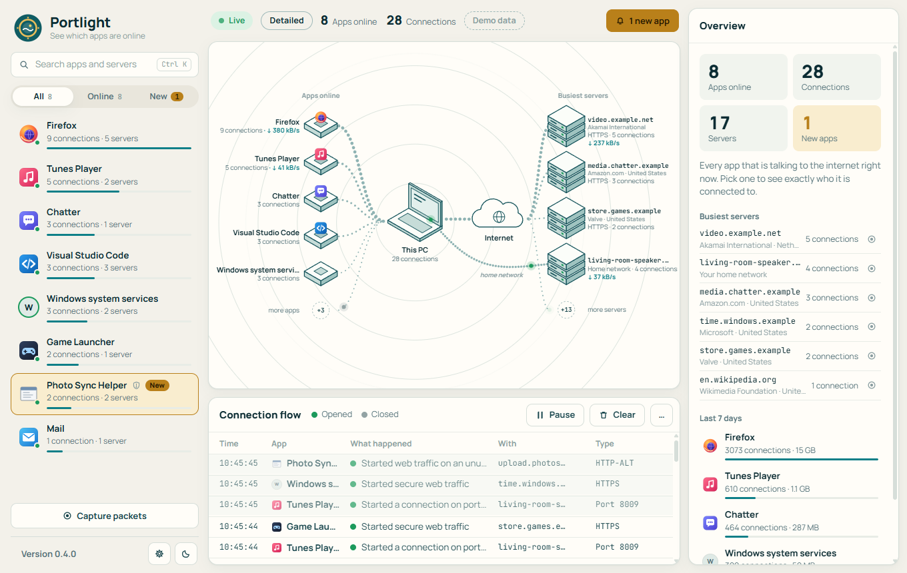
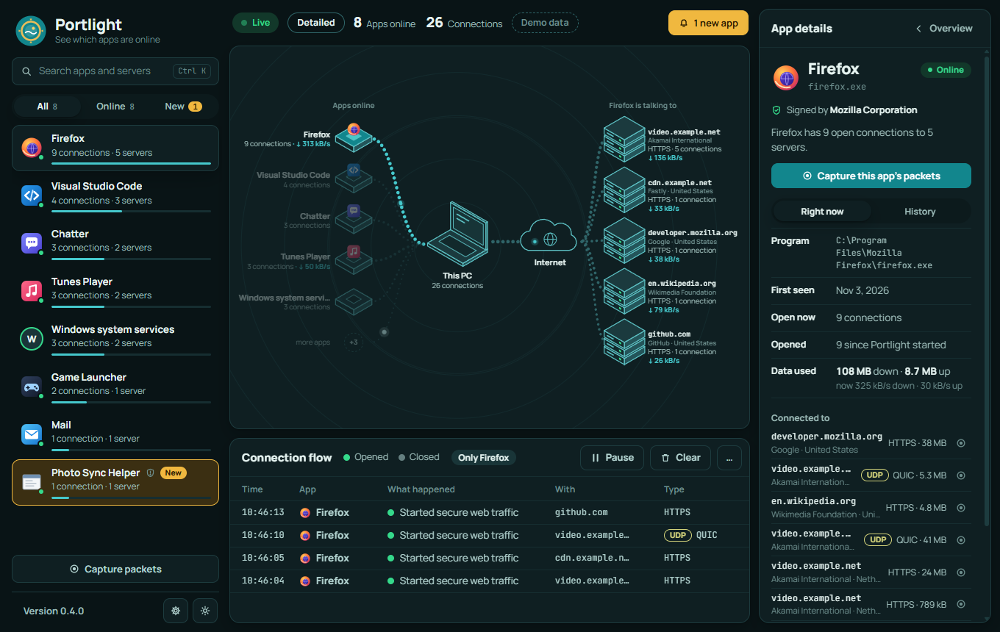
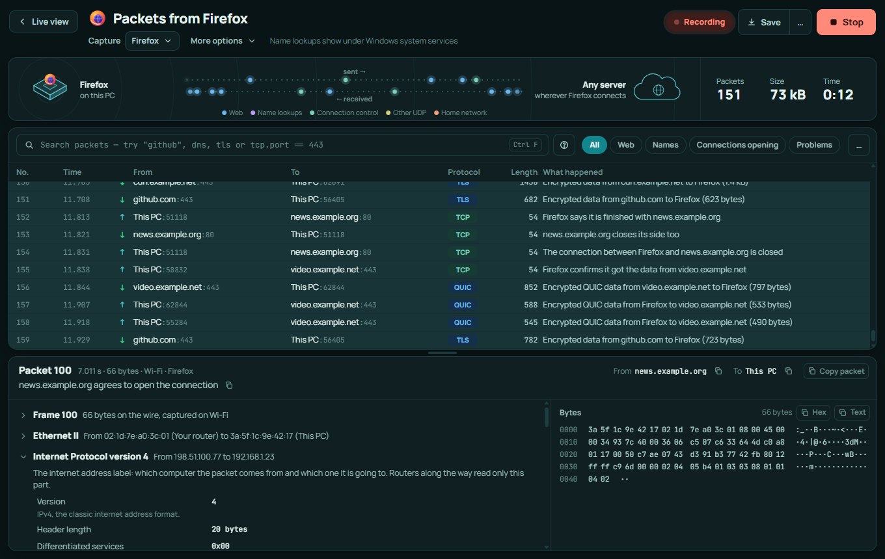
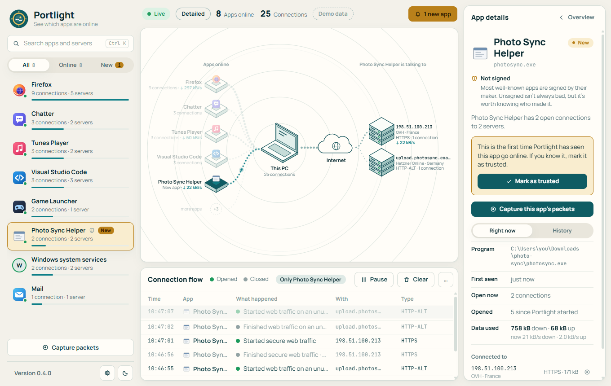
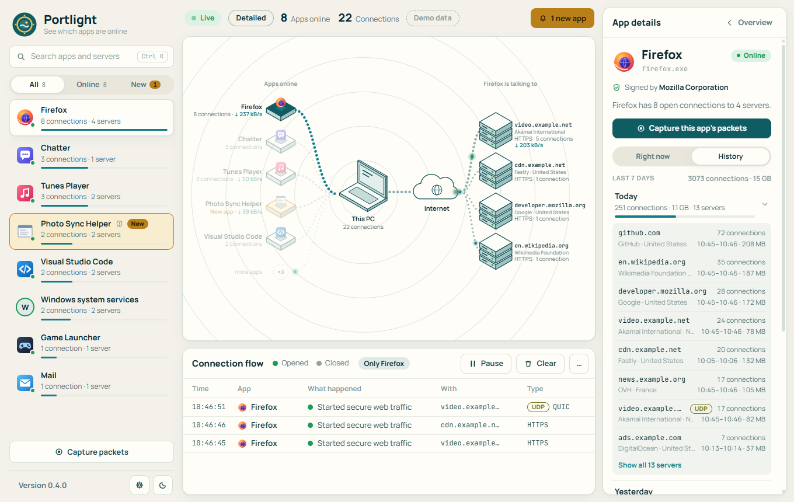
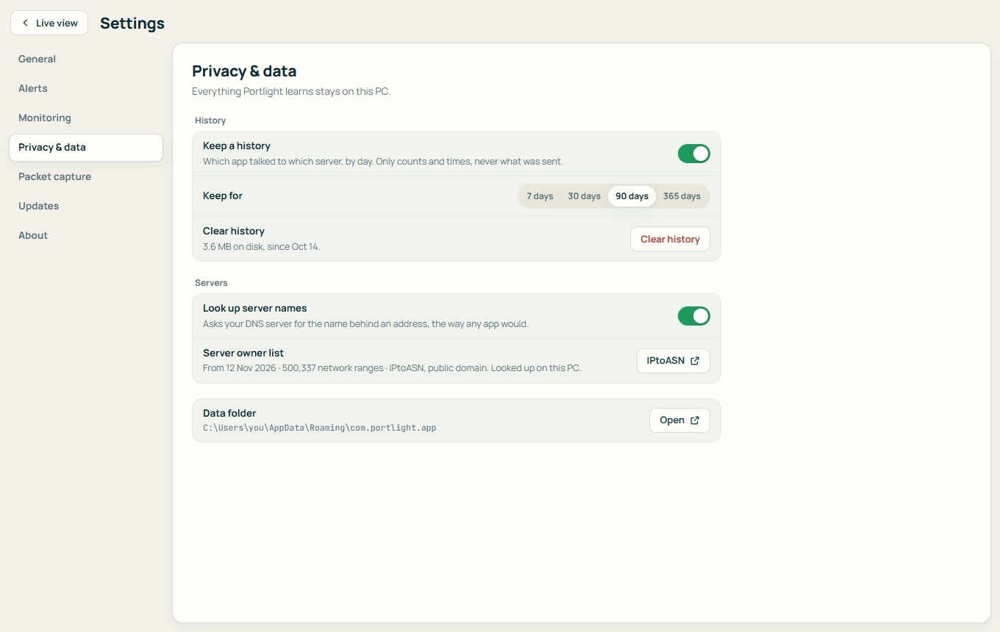
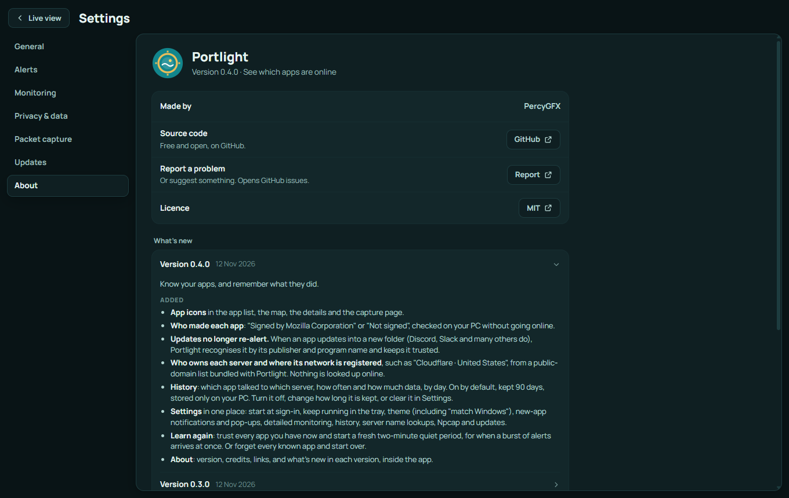

<p align="center">
  
</p>

<h1 align="center">Portlight</h1>

<p align="center">
  See which apps on your PC are online, who they are talking to, and get told the first time a new app connects.<br>
  A friendlier take on network monitoring: apps first, packets when you want them. Written in Rust.
</p>

<p align="center">
  <a href="https://github.com/PercyGFX/Portlight/releases/latest"><b>Download the latest release</b></a>
  &nbsp;&nbsp;|&nbsp;&nbsp; <a href="CHANGELOG.md">What's new</a>
  &nbsp;&nbsp;|&nbsp;&nbsp; <a href="docs/PLAN.md">Roadmap</a>
  &nbsp;&nbsp;|&nbsp;&nbsp; Windows 10 (1809+) and Windows 11, 64-bit
</p>

<p align="center">
  
</p>

---

## Contents

- [Why Portlight](#why-portlight)
- [Features](#features)
- [Screenshots](#screenshots)
- [Install](#install)
- [Using Portlight](#using-portlight)
- [New-app alerts](#new-app-alerts)
- [Detailed monitoring](#detailed-monitoring)
- [Packet capture](#packet-capture)
- [Settings](#settings)
- [Your data](#your-data)
- [Updates](#updates)
- [Uninstall](#uninstall)
- [What it cannot do yet](#what-it-cannot-do-yet)
- [Roadmap](#roadmap)
- [For developers](#for-developers)
- [Credits](#credits)
- [License](#license)

## Why Portlight

Tools like Wireshark show you every packet and leave you to work out what it means. Most people have a simpler question: **which programs on my PC are using the internet, and who are they talking to?**

Portlight answers that first. It starts from apps ("Firefox has 4 connections to 3 servers"), describes what happens in plain words ("Started secure web traffic with github.com"), and tells you when a program you have never seen online before makes its first connection.

When you do want packets, you don't pick a network card and type filters as you would in Wireshark. You click an app, a server or a connection, and Portlight captures just that and explains each packet in plain words.

## Features

**See**

- Every app with an open internet connection, by its real name ("Visual Studio Code", not `Code.exe`), busiest first.
- A **live map**: your apps, this PC, the internet, and the servers on the other end. A dot travels along the lanes whenever a connection opens or closes.
- **Per-app details**: where the program lives on disk, when Portlight first saw it, and every server it is connected to right now.
- A **connection flow** table under the map: connections opening and closing as they happen, in plain words ("Started secure web traffic"), with the server and the kind of traffic.

**Look closer**

- **Detailed monitoring** (optional, one administrator prompt to turn on): every connection including very short ones, UDP, the data each app uses, and the real site names apps looked up.
- **Packet capture** for one app, one server, one site, one connection or everything, with plain-English summaries, a layer-by-layer breakdown and the raw bytes.
- **Search and filter** packets with plain words or Wireshark-style filters (`dns`, `tls`, `tcp.port == 443`).
- **Save for Wireshark** (`.pcapng`), or export the list as CSV or the full breakdown as text or JSON (handy for reports, or for pasting into an AI chat). Save everything, only what your search shows, one packet or a range.
- **Stop automatically** after a number of seconds, packets or megabytes.
- **Export the live view**: apps, open connections and connection history as CSV.

**Know your apps**

- **App icons** and **who made each app** ("Signed by Mozilla Corporation" or "Not signed").
- **Who owns each server** and where its network is registered ("Cloudflare · United States"), looked up on your PC.
- **History**: what each app talked to, by day, kept on your PC for 90 days (you can change or turn this off).

**Be told**

- A Windows notification, and an alert in the window, the **first time an app goes online**. You decide whether to trust it.
- Keeps watching from the tray when the window is closed.

**Around it**

- Light and dark themes. Search with `Ctrl K`, pause with `Space`.
- No administrator rights needed for the basics, and no driver. Detailed monitoring and packet capture are opt-in.
- Updates itself from GitHub Releases.
- Everything stays on your PC. See [Your data](#your-data).

## Screenshots

The screenshots use the app's built-in demo data, so no real connections are shown.

<p align="center"></p>
<p align="center"><sub>Pick an app and the map narrows to it: who made it, the servers it talks to and who owns them, and how much data it uses.</sub></p>

<p align="center"></p>
<p align="center"><sub>Capture one app's packets in one click. Every packet is explained in plain English, with the full breakdown and the bytes one click away.</sub></p>

<p align="center"></p>
<p align="center"><sub>A new app: who made it (or that nobody signed it), where it runs from, what it connected to, and a button to mark it as trusted.</sub></p>

<p align="center"></p>
<p align="center"><sub>History: what each app talked to, day by day, kept only on your PC.</sub></p>

<p align="center"></p>
<p align="center"><sub>Settings in one place, with a plain sentence under each choice.</sub></p>

<p align="center"></p>
<p align="center"><sub>About, with what's new in every version.</sub></p>

## Install

1. Download `Portlight-Setup-x.y.z.exe` from the [latest release](https://github.com/PercyGFX/Portlight/releases/latest).
2. Run it. It installs for your user only, so there is no administrator prompt.
3. Leave **Start Portlight when I sign in** ticked if you want alerts all the time.

Windows may show **"Windows protected your PC"** because the installer is not code-signed yet. Choose **More info**, then **Run anyway**.

Portlight draws its window with Microsoft's WebView2, which is part of Windows 11 and of Microsoft Edge on Windows 10. The installer tells you if it is missing.

## Using Portlight

| To do this | Do this |
|---|---|
| See what one app is doing | Click it in the list or on the map |
| Go back to the big picture | Press `Esc`, or click **Overview** |
| Switch between light and dark | The sun or moon button at the bottom of the sidebar |
| Find an app or a server | `Ctrl K`, then type |
| Freeze the map and the table to read them | `Space`, or **Pause** |
| Review new apps | Click the **new apps** button above the map |
| Change settings, see what's new | The gear at the bottom of the sidebar |
| Too many new-app alerts at once | Settings › Alerts › **Learn again** |
| Turn on detailed monitoring | **Turn on** in the note above the map, or in Settings (one Windows prompt) |
| Capture an app's packets | Select the app, then **Capture this app's packets** |
| Capture one server or connection | The capture buttons next to it in the details column |
| Search or filter packets | Type in the box on the capture page; `Ctrl F` jumps there |
| Save a capture for Wireshark | **Save** on the capture page |
| Keep it running in the background | Close the window; Portlight stays in the tray |
| Quit completely | Right-click the tray icon, then **Quit** |

## New-app alerts

The first time you run Portlight it spends **two minutes learning**: every app it sees online in that time is noted as already known, so you are not flooded with alerts. A banner shows the countdown.

After that, the first connection from an app Portlight has never seen raises a Windows notification and marks the app as **New**. Open it to see where the program runs from and what it connected to, then choose **Mark as trusted** if you recognise it. Portlight remembers, so each app alerts once.

An app is recognised by the location of its program file, and by who signed it. An app that updates itself into a new folder (Discord, Slack and others do) is recognised by its publisher and program name and stays trusted. An unsigned program in a new folder still counts as new.

## Detailed monitoring

Windows only tells programs about every connection, with byte counts and the site names apps looked up, if they run with administrator rights. Rather than run the whole window that way, Portlight can install a small background service, **Portlight Collector**, which reads those events and passes them to the window over a private, local channel.

- Turn it on from the note above the map. Windows asks once for permission.
- It is copied to `C:\Program Files\Portlight` and starts with Windows. It only collects; all decisions are made in the window.
- Turn it off in Settings › Monitoring (one more prompt), or uninstall Portlight, which removes it too.
- If it is not running, Portlight goes back to basic monitoring by itself.

## Packet capture

Packet capture needs **[Npcap](https://npcap.com/#download)**, the free capture driver Wireshark also uses. Its licence doesn't allow Portlight to include it, so the capture page tells you if it's missing and links to it. Install it with the default options.

Captures stay in memory until you save them or start another; they are limited to 200,000 packets or 512 MB. Encrypted traffic stays encrypted: you see who, when and how much, not what.

## Settings

The gear at the bottom of the sidebar opens Settings. Everything has a sensible default, so most people never need it.

| Section | What you can change |
|---|---|
| General | Start when you sign in, keep running in the tray when the window closes, light, dark or match Windows |
| Alerts | Windows notifications and pop-ups for new apps, **Learn again** (trust what you have and stay quiet for two minutes), forget all known apps |
| Monitoring | Detailed monitoring on or off |
| Privacy & data | History on or off and how long it is kept, clear history, server name lookups on or off, the date of the server owner list |
| Packet capture | Whether Npcap is installed |
| Updates | Automatic updates, check now, update |
| About | Version, credits, links and what's new in every version |

## Your data

- Portlight keeps two small files in `%APPDATA%\com.portlight.app`: the list of apps it has seen (`known-apps.json`) and your settings (`settings.json`). Nothing else is stored, and no connection history is written to disk.
- **History** (on by default): `history.sqlite` in the same folder holds daily totals of which app talked to which server, how often and how much data, for 90 days. No packet contents. Turn it off, change how long it is kept, or clear it in Settings › Privacy & data.
- **Server owners** come from a list bundled with Portlight (`owners.bin`), so looking them up sends nothing anywhere. **Signatures** are checked without going online.
- Captured packets are kept in memory only, and written to disk only when you save them.
- The optional collector service writes problems (not your traffic) to `C:\ProgramData\Portlight\collector.log`.
- It sends nothing about you or your connections anywhere.
- It makes two kinds of request itself: **name lookups** to your usual DNS server, to turn server addresses into names (turn these off in Settings › Privacy & data), and an **update check** to GitHub twice a day (Settings › Updates).
- The window is drawn by Microsoft's WebView2, which can contact Microsoft on its own account, as it does inside any app that uses it. You will see it in Portlight's list as "Microsoft Edge WebView2".

## Updates

Settings › Updates shows the version and any update. The installed app checks GitHub for a new release a couple of minutes after it starts, then every 12 hours. With **Install updates automatically** on (the default), it downloads the installer, checks it against the SHA-256 that GitHub publishes, and installs it quietly; your list of known apps is untouched. With it off, the version button at the bottom of the sidebar shows **Update to x.y.z** and waits for you.

## Uninstall

**Settings > Apps > Installed apps > Portlight > Uninstall.** The uninstaller closes Portlight, removes it and its sign-in entry, removes the collector service if you turned it on (Windows asks for permission), and asks whether to delete the list of apps it has seen. Npcap, if you installed it, is a separate program with its own uninstaller.

## What it cannot do yet

- **Basic monitoring has gaps.** Without the collector service, Portlight reads the list of open connections twice a second, so very short connections can be missed; it sees TCP only, has no byte counts, groups Windows system processes together, and names servers by reverse lookup. Turn on detailed monitoring to close all of these.
- **Name lookups belong to Windows.** Windows makes DNS lookups on apps' behalf, so they appear under "Windows system services" rather than the app that asked.
- **Unsigned apps that move folders alert again.** Portlight recognises a moved app by its maker's signature; without one, a new folder means a new app.
- **Server countries are where the network is registered**, not necessarily where the server stands.
- **No blocking or unusual-activity hints yet.** Both are on the [roadmap](#roadmap).
- **It cannot see inside encrypted traffic.** No tool can: you see who, when and how much, not the contents.

## Roadmap

The full plan, with the reasons behind each decision, is in [docs/PLAN.md](docs/PLAN.md).

| | Milestone | What it brings |
|---|---|---|
| ✅ | 0.1–0.2 Monitoring | Live apps, map, connection flow, new-app alerts |
| ✅ | 0.3 Detailed monitoring and packet capture | Every connection, UDP, data used, real site names; capture by app, server or connection; Wireshark export |
| ✅ | 0.4 App identity and history | Icons, publisher signatures, server owners, daily history, Settings and About |
| Next | Unusual-activity hints | "Looks unusual, and here's why": odd folders, fake Windows names, beaconing, big uploads, known-bad servers. No AI needed |
| Then | Blocking | Block an app, an address or a site with the Windows firewall; a Block button on new-app alerts; strict mode |
| Later | Capture follow-ups | Follow a whole conversation, open saved captures, capture to disk |
| Later | Replay and polish | Replay a capture on the map, translations |
| Later | MCP server | Let Claude Desktop and other AI assistants read Portlight, with your OK for any action |
| Later | Ask questions | Ask Portlight about what you see, with your own AI key |
| Later | Code signing, Linux, macOS | |

## For developers

```powershell
npm install
npm run tauri dev          # the desktop app, with live reload
npm run dev                # just the UI in a browser, with demo data
cargo test --workspace     # the tests
cargo run -p portlight-cli # the live feed in a console, no window
target\debug\portlight-service.exe console   # the collector's feed (admin prompt)
installer\build.ps1        # release exe and installer
```

- [docs/ARCHITECTURE.md](docs/ARCHITECTURE.md): how the code is organised and how data flows through it.
- [docs/DEVELOPMENT.md](docs/DEVELOPMENT.md): setup, everyday commands, and how to cut a release.
- [docs/PLAN.md](docs/PLAN.md): what is built, what is next, and the decisions behind it.

## Credits

- The idea of showing traffic as a live isometric map above a table of events was inspired by [Protocol Explorer](https://protocol-explorer-alpha.vercel.app/), designed by Dilum Sanjaya. Portlight's colours, typefaces, layout and drawings are its own, and it shares no code or artwork with that project.
- Server owner and country data: [IPtoASN](https://iptoasn.com/) by Frank Denis, public domain (PDDL v1.0).
- The typefaces are [Manrope](https://manropefont.com/) and [JetBrains Mono](https://www.jetbrains.com/lp/mono/), both under the SIL Open Font License.
- Built with [Tauri](https://tauri.app/) and [React](https://react.dev/).

## License

[MIT](LICENSE)
