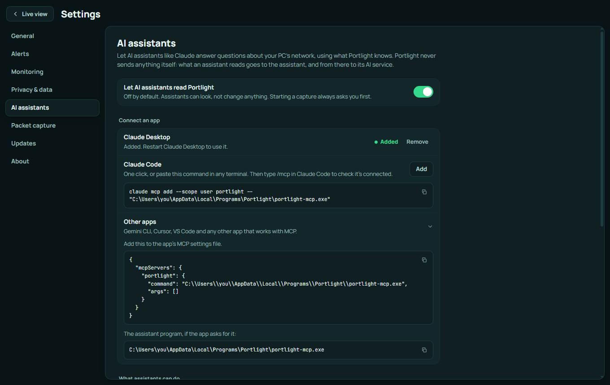
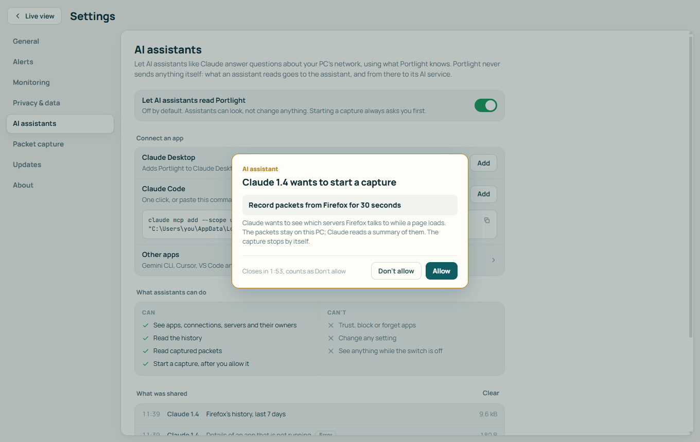

# Portlight for AI assistants (MCP)

Portlight can answer questions from AI assistants such as Claude Desktop, Claude Code, Gemini CLI, Cursor and VS Code. It uses the [Model Context Protocol](https://modelcontextprotocol.io) (MCP), the standard way AI apps talk to tools. You ask in plain words, the assistant asks Portlight, and you get an answer about your own PC:

- *"What's online on my PC right now?"*
- *"Which app used the most data this week?"*
- *"Is Photo Sync Helper safe? Who made it and who does it talk to?"*
- *"Who owns 140.82.112.3?"*
- *"Capture what Firefox sends for 30 seconds and explain the DNS lookups."*

It is **off until you turn it on**, it can only look (it can't change anything), and it can only start a capture after you click **Allow** in Portlight.

## Contents

- [Set it up](#set-it-up)
- [How it works](#how-it-works)
- [What assistants can do](#what-assistants-can-do)
- [Tools](#tools)
- [Your OK for captures](#your-ok-for-captures)
- [Privacy](#privacy)
- [Troubleshooting](#troubleshooting)
- [Technical details](#technical-details)

## Set it up

1. Open Portlight, then **Settings › AI assistants**.
2. Turn on **Let AI assistants read Portlight**.
3. Connect your app:

| App | How |
|---|---|
| **Claude Desktop** | Click **Add**, then quit and reopen Claude Desktop |
| **Claude Code** | Click **Add**, or paste the `claude mcp add ...` command shown there into any terminal. Type `/mcp` in Claude Code to check it's connected |
| **Gemini CLI, Cursor, VS Code, others** | Open **Other apps**, copy the settings and paste them into the app's MCP settings file |

<p align="center"></p>

Then ask your assistant something about your network. That's all.

### Setting it up by hand

If an app isn't listed, give it this program (installed next to Portlight):

```
%LOCALAPPDATA%\Programs\Portlight\portlight-mcp.exe
```

Most apps want it in this shape:

```json
{
  "mcpServers": {
    "portlight": {
      "command": "C:\\Users\\you\\AppData\\Local\\Programs\\Portlight\\portlight-mcp.exe",
      "args": []
    }
  }
}
```

For Claude Code:

```powershell
claude mcp add --scope user portlight -- "%LOCALAPPDATA%\Programs\Portlight\portlight-mcp.exe"
```

Settings › AI assistants shows the exact path for your PC, with copy buttons.

## How it works

You never start `portlight-mcp.exe` yourself. The AI app starts it in the background when it opens and closes it when it quits.

```
Claude, Gemini, Cursor ...
        │  starts portlight-mcp.exe and asks it questions (MCP)
        ▼
portlight-mcp.exe        a small go-between with no window
        │  passes each question through a private pipe that only your Windows account can open
        ▼
Portlight                 the app you already have open, which has the answers
```

So for answers:

- **Portlight must be running.** The tray icon is enough; the window can stay closed.
- **The switch must be on.** When it's off, assistants are told to ask you to turn it on, and get nothing else.

## What assistants can do

| Can | Can't |
|---|---|
| See apps, connections, servers and who owns them | Trust, block or forget apps |
| Read your history | Change any setting |
| Read captured packets and explain them | See anything while the switch is off |
| Start a capture, **after you click Allow**; it stops by itself | Start a capture without asking |

## Tools

These are the tools Portlight gives assistants. You don't call them yourself; the assistant picks them from your question.

| Tool | What it answers |
|---|---|
| `portlight_status` | An overview: monitoring mode, apps online, connections, servers, new apps, whether a capture is running |
| `list_apps` | Apps seen online, busiest first, with who signed them and the data they used. Can show only new (not yet trusted) apps |
| `get_app` | Everything about one app: where it lives, who signed it, when it was first seen, every connection with the server's owner and country |
| `list_connections` | Connections open right now, for every app or one app |
| `recent_activity` | Connections that opened or closed in the last minutes |
| `new_apps` | Apps that went online for the first time and aren't trusted yet |
| `lookup_server` | Who owns an address or site, its country, its names, and which apps use it |
| `app_history` | One app's daily history: connections, data and busiest servers, up to 90 days |
| `history_summary` | Every app's daily totals, for "what used the most data this week" |
| `capture_status` | Whether a capture is running, what it records, and how many packets it holds |
| `read_packets` | Rows from the capture, each explained in plain English. Accepts filters like `dns`, `tls` or `tcp.port == 443` |
| `explain_packet` | The full layer-by-layer breakdown of one packet, and its raw bytes if asked |
| `start_capture` | Asks you to allow a capture of one app, one server or everything, for 5 to 300 seconds (30 by default) |
| `stop_capture` | Stops the running capture. Its packets stay readable |

All tools except `start_capture` and `stop_capture` are marked read-only, so assistants that support it can run them without asking you each time.

## Your OK for captures

When an assistant wants packets, Portlight shows a card over whatever page is open:

<p align="center"></p>

- **Allow** starts it. The capture stops by itself after the time shown (or 5,000 packets).
- **Don't allow**, closing the card, or waiting 2 minutes all count as no.
- A capture started this way shows on the Packet capture page like any other; you can stop or save it there.
- Packet capture needs [Npcap](https://npcap.com/#download). Without it, the assistant is told to ask you to install it.

## Privacy

- Portlight itself still sends nothing anywhere.
- What an assistant reads goes to that assistant app, and from there to its AI service, under that service's terms. Treat it like pasting the same thing into a chat.
- **What was shared**, at the bottom of Settings › AI assistants, lists every request: the time, the app, what it asked and how much was sent back. It is kept in memory only, and cleared when Portlight quits.
- Only your own Windows account can reach Portlight this way, and only from this PC.
- Assistants are limited to 120 requests a minute.
- Encrypted traffic stays encrypted: an assistant learns who, when and how much, not what was said.
- Turn the switch off at any time. Uninstalling Portlight also removes it from Claude Desktop's and Claude Code's settings.

## Troubleshooting

| What you see | What to do |
|---|---|
| "Portlight isn't running" | Open Portlight (or check it's in the tray) and ask again |
| "AI assistant access is turned off" | Turn on the switch in Settings › AI assistants |
| Claude Desktop doesn't list Portlight | Quit Claude Desktop fully (from its tray icon too), then reopen it |
| Claude Code doesn't list it | Run `claude mcp list`. If `portlight` is missing, click **Add** again or paste the command |
| "Not part of this copy of Portlight" | You're running a development build; see [DEVELOPMENT.md](DEVELOPMENT.md#working-on-ai-assistants-mcp) |
| A capture request says Npcap is missing | Install [Npcap](https://npcap.com/#download) with its default options |

## Technical details

For people building or checking MCP clients.

- **Transport:** stdio, one JSON-RPC message per line. Logs go to stderr.
- **Protocol versions:** `2026-07-28` (stateless: version and client info in each request's `_meta`, `server/discover`) and the older `initialize` handshake for `2025-11-25`, `2025-06-18`, `2025-03-26` and `2024-11-05`. An unknown version gets error `-32022` with the supported list.
- **Server name:** `portlight`. Instructions for the model are sent with the server info.
- **Results:** each tool returns the answer as pretty JSON text plus `structuredContent`. Problems such as "app not found" come back as tool results with `isError: true`, so the model can read them and try again.
- **Bridge:** `portlight-mcp.exe` holds no data. It forwards each tool call to the Portlight window over the named pipe `\\.\pipe\portlight-assistant-<your SID>`, which only your account can open and which refuses remote clients. One request and one reply per connection.
- **Code:** the tool catalogue is `crates/core/src/assistant.rs`, the protocol is `crates/mcp/src/protocol.rs`, and the answers are `src-tauri/src/assistant.rs`. See [ARCHITECTURE.md](ARCHITECTURE.md#ai-assistants-mcp).
